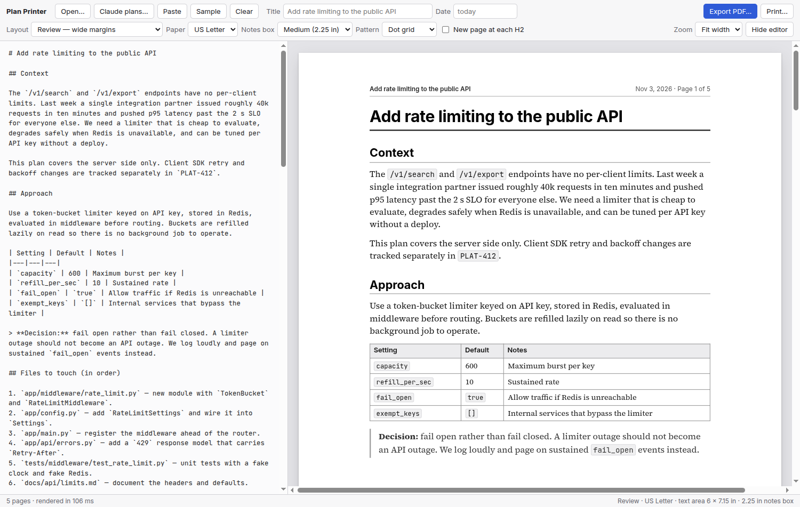
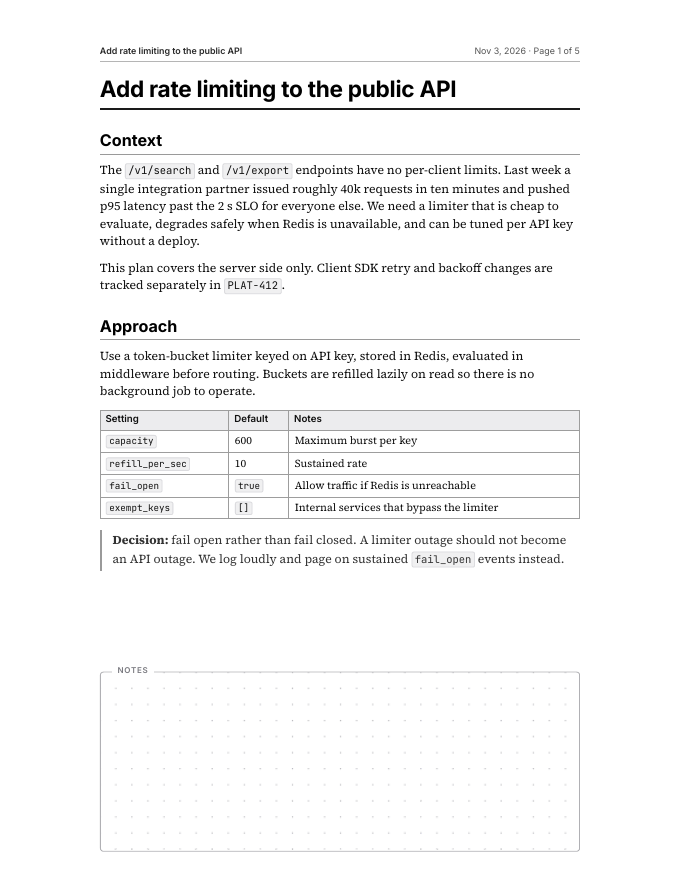
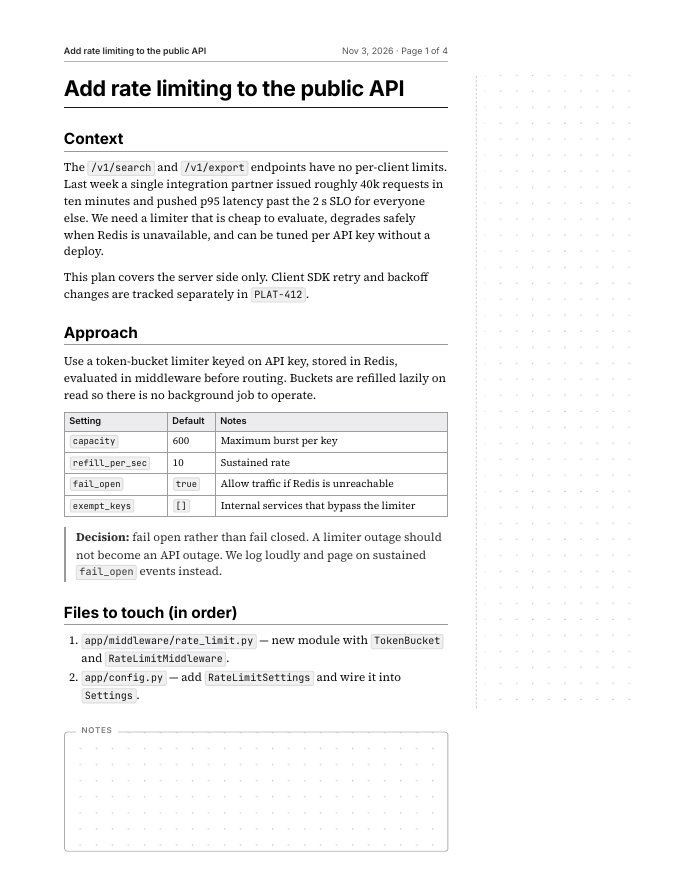
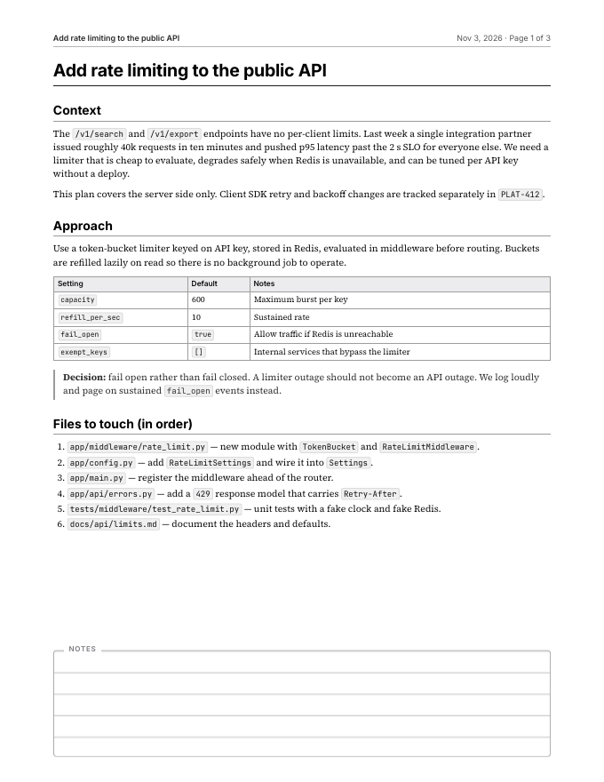
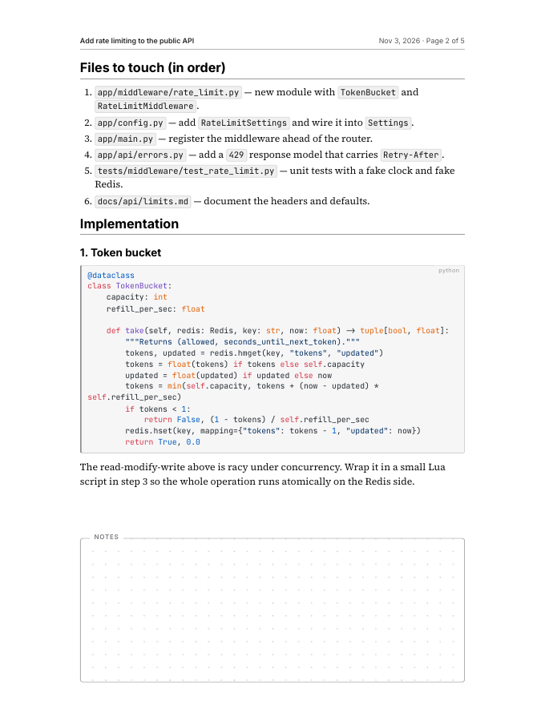

# Plan Printer

Paste a Claude Code plan (or any Markdown) and get a clean, paginated document
you can print and mark up with a pen: wide side margins, a dot-grid **notes box
on every page**, and a running header with the title, date and *Page X of Y*.



The preview *is* the printout. Pages are laid out with [Paged.js](https://pagedjs.org/)
inside the app, so what you see on screen is exactly what comes out of the
printer or the PDF, page for page.

## Three layouts

| Review | Margin notes | Dense |
| --- | --- | --- |
|  |  |  |
| Wide, symmetric 1.25 in side margins, 11 pt body. The default. | Narrow text column with a 2.9 in dotted column down the right for line-by-line comments. | 0.75 in margins and 9.5 pt body for long plans. |

Every layout also has:

- **Paper**: US Letter (default) or A4.
- **Notes box**: small (1.5 in), medium (2.25 in), large (3 in) or none.
- **Pattern**: dot grid, ruled lines or blank, for the notes box and the margin column.
- **New page at each H2**: one section per sheet for plans you want to shuffle.

Code blocks keep their syntax highlighting and split between whole lines when they cross
a page; task-list items print as real tick boxes; tables keep their header row and never
split a row; headings never end up alone at the bottom of a page.



## Install and run

Requires [Node.js](https://nodejs.org/) 18 or newer.

```bash
git clone https://github.com/Archimiddles/MarkdownDocumentMaker.git
cd MarkdownDocumentMaker
npm install
npm start
```

`npm install` downloads Electron (about 100 MB) and bundles the renderer; `npm start`
opens the app with the sample plan loaded.

<details>
<summary>Ubuntu 24.04 and newer: "SUID sandbox helper binary was found, but is not configured correctly"</summary>

Ubuntu restricts unprivileged user namespaces, which Electron's sandbox needs when it is
installed through npm. `npm start` detects this and relaunches once with the sandbox
disabled. To fix it permanently (repeat after upgrading Electron):

```bash
sudo chown root:root node_modules/electron/dist/chrome-sandbox && sudo chmod 4755 node_modules/electron/dist/chrome-sandbox
```

</details>

## Using it

1. Get a plan into the editor: paste it, press **Paste** to pull it from the clipboard,
   **Open…** a `.md` file, drop a file onto the editor, or use **Claude plans…** to browse
   `~/.claude/plans` directly (the button appears when that folder exists).
2. Pick a layout, paper size and notes box. The title is taken from the first heading and
   the date is today; both can be overridden in the toolbar.
3. **Export PDF…** writes a PDF through Chromium's own print engine, or **Print…** sends
   it straight to a printer. If the system print dialog misbehaves, export the PDF and
   print that.

The last text and settings are remembered between launches.

| Shortcut | Action |
| --- | --- |
| `Ctrl+O` | Open a Markdown file |
| `Ctrl+S` | Save the editor contents as Markdown |
| `Ctrl+E` | Export PDF |
| `Ctrl+P` | Print |
| `Ctrl+\` | Hide or show the editor |

## How it works

- `main.js`: Electron main process. Window, menu, file dialogs, `printToPDF` and `print`.
  The renderer is sandboxed with context isolation; `preload.js` exposes a handful of
  IPC calls and nothing else.
- `renderer/src/app.js`: Markdown → HTML with [marked](https://marked.js.org/) and
  [highlight.js](https://highlightjs.org/), sanitised with DOMPurify, then paginated by
  Paged.js. The header strip, notes box and margin column are injected into each page
  *after* layout, so they never push content around.
- `renderer/src/page.css`: everything about the printed page. Handed to Paged.js as text
  because it has to parse the `@page` rules itself. The `@page` size and margins are
  generated from the chosen layout in `app.js`.
- `renderer/src/ui.css`: the application chrome, plus the print rules that hide it.
- `scripts/build.js`: a small esbuild script that bundles the renderer and the
  self-hosted fonts (Inter, Source Serif 4, JetBrains Mono via Fontsource).

## Tests

```bash
npm test
```

Launches the real app in a headless test mode, renders nine layout/paper/content
combinations (including a code block longer than a page, a wide table, nested task lists
and an empty document), exports each through `printToPDF`, and checks with `pdfinfo`
that every PDF has the paper size you asked for and exactly as many pages as the preview
showed. Screenshots and first-page renders land in `test/output/` for eyeballing.
Needs `poppler-utils` (`pdfinfo`, `pdftoppm`) on the PATH.

## Packaging (optional)

```bash
npm run dist
```

Builds an AppImage and a `.deb` into `release/` with electron-builder, fetched on demand
by `npx`. The `.deb` installs an AppArmor profile so the sandbox works on Ubuntu 24.04;
an AppImage on Ubuntu 24.04 needs to be started with `--no-sandbox`.

## License

[MIT](LICENSE). Do what you like with it.
