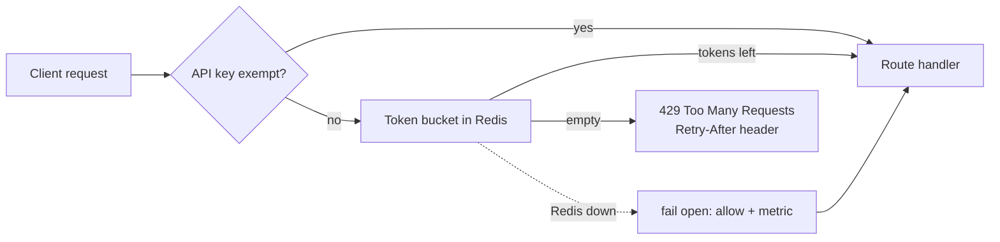
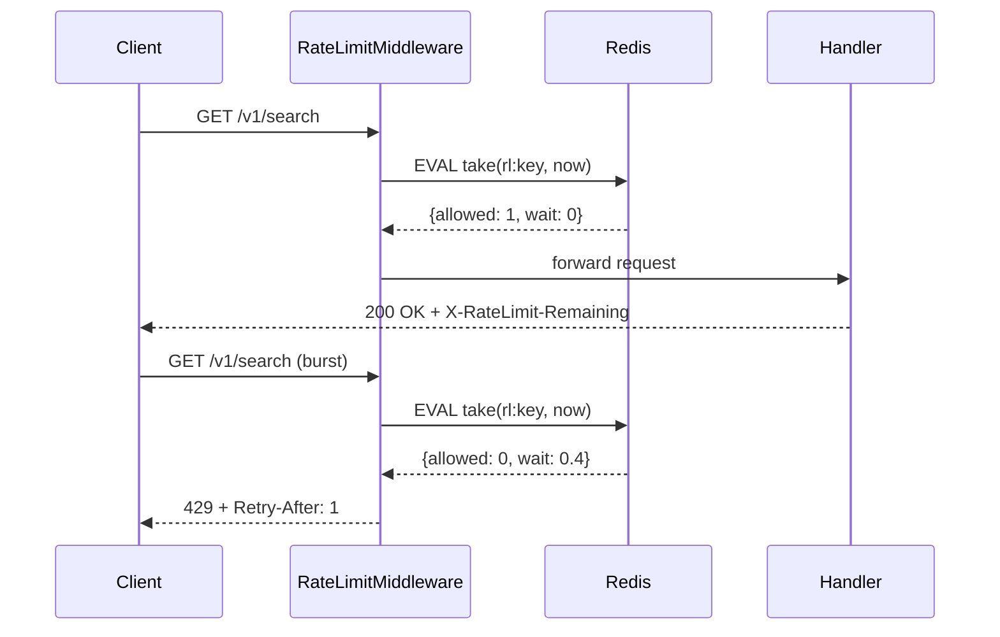
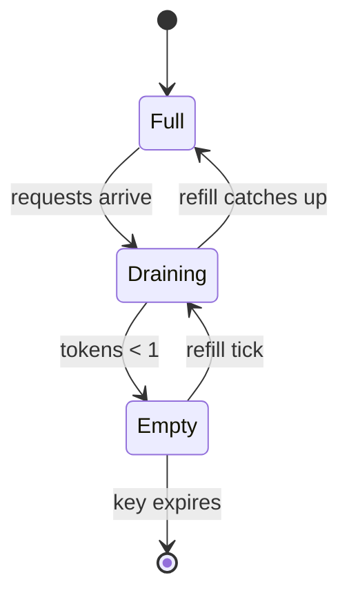
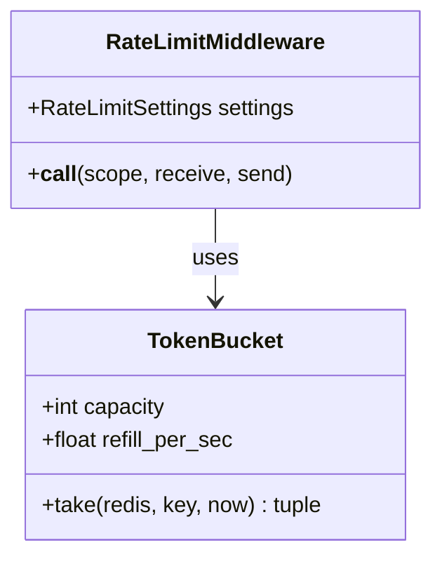
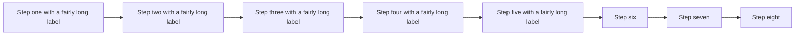

# Diagrams: Mermaid rendering

## Flowchart



Text after the flowchart keeps flowing normally.

## Sequence diagram



## State diagram



## Class diagram



## An invalid diagram

The block below has a syntax error and should fall back to showing the source with a note, not break the page.

```mermaid
flowchart LR
    A --> B --> --> C
    this is not valid [[
```

## A very wide diagram



Closing paragraph after all diagrams, with a task:

- [ ] Review the diagrams against the plan
