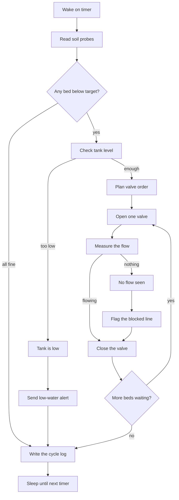
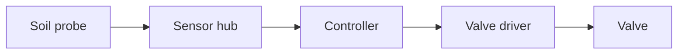

# Greenhouse watering controller: build plan

This is a made-up plan used only by the tests. It exists to put a tall diagram in an awkward spot: straight after enough text that the diagram cannot fit in what is left of the page, so it has to move to the next page in one piece.

## How one watering cycle runs

> **In plain English:** The controller wakes up on a timer, checks how dry each bed is, and waters only the beds that need it. It also checks that the tank has water and that water really flows when a valve opens. Without those two checks a dry tank or a blocked pipe would go unnoticed for days.

Every bed has one soil probe and one valve. The controller never opens two valves at the same time, because the pump can only keep pressure on one line. A cycle therefore handles the beds one after another, and each bed gets the same three steps: open the valve, watch the flow meter, close the valve again. The order of the beds is worked out once per cycle, driest bed first, so that a cycle cut short by a low tank has still watered the beds that needed it most.

The paragraph you are reading is here on purpose. Together with the heading and the callout above it takes up more than a fifth of the page in every layout, which leaves too little room for the flowchart below. Before the fix this test guards, a diagram in exactly this position could be torn in two by the page break and lose its colours, turning every box solid black.


Caption: one watering cycle from wake-up to sleep. The left-hand path is the normal one. The two side paths end the cycle early (tank low) or skip a bed (blocked line), and every path ends in the cycle log.

### Reading the diagram

Start at the top and follow the arrows down. A diamond is a question the controller asks itself, and the label on each arrow leaving it is the answer that takes that way out. The long arrow from the first diamond straight down to the log is the most common path of all: on a rainy week nothing is dry, so the controller writes one line to the log and goes back to sleep.

The loop near the bottom is what makes one cycle handle several beds. After a valve is closed the controller asks whether more beds are waiting. If so it goes back up and opens the next valve, and only when the list is empty does it carry on to the log.

## Sensor wiring

> **In plain English:** Each probe is read through a small hub so the controller needs only one cable into the greenhouse. This part says which wire goes where and what a healthy reading looks like, so a broken probe can be told apart from dry soil.

The probes are capacitive, which means they measure how well the soil holds an electric charge rather than passing a current through it. They do not corrode, and they keep working when fertiliser changes how salty the soil is. Each probe has three wires: power, ground and signal. The signal is a voltage between 1.2 and 2.8 volts, and it goes down as the soil gets wetter.


Caption: the signal path for one bed. The hub and the valve driver sit in the same box.

A reading outside the healthy range is never treated as "very wet" or "very dry". It is treated as a fault, the bed is skipped, and the fault is written to the log. The table lists what each reading means.

| Reading | What it means | What the controller does |
|---|---|---|
| Below 1.0 V | Wire shorted to ground | Skip the bed and log a fault |
| 1.2 to 1.8 V | Soil is wet | Nothing |
| 1.8 to 2.4 V | Soil is drying out | Water if below the bed's target |
| 2.4 to 2.8 V | Soil is dry | Water |
| Above 3.0 V | Probe unplugged | Skip the bed and log a fault |

The targets are per bed, because tomatoes and lettuce do not want the same soil. They live in one small settings file that can be edited by hand:

```yaml
beds:
  - name: tomatoes
    probe: 1
    valve: 1
    water_below_volts: 2.1
    seconds_per_run: 90
  - name: lettuce
    probe: 2
    valve: 2
    water_below_volts: 1.9
    seconds_per_run: 45
  - name: herbs
    probe: 3
    valve: 3
    water_below_volts: 2.3
    seconds_per_run: 30
tank:
  minimum_litres: 20
```

Things to check once the wiring is done:

- [ ] Every probe reads between 1.2 and 2.8 volts when pushed into damp soil
- [ ] Pulling a probe's plug makes its reading jump above 3 volts
- [ ] Each valve clicks when its output is switched on by hand
- [ ] The flow meter counts while a valve is open and stops when it closes

## Rollout

> **In plain English:** The controller is switched on in three steps, and it does not open a single valve until the second one. If a step goes wrong the previous step is still running, so the plants are never left without water.

1. **Watch only.** For one week the controller runs every cycle but keeps the valves closed. It only writes to the log what it would have done. The log is compared with what was watered by hand.
2. **One bed.** The herbs are handed over first, because they forgive mistakes. The other beds stay on hand watering. This step lasts until two full weeks pass without a fault in the log.
3. **All beds.** The remaining beds are switched over one per day. The low-water alert is tested on the first day by letting the tank run down on purpose.

Rolling back is the same at every step: turn the controller's valve outputs off with the switch on the box. The valves close by themselves when they lose power, and hand watering carries on as before. Nothing else has to be undone, because the controller keeps no state apart from its log.

The log itself is plain text with one line per cycle and one extra line per fault. A week of normal running is about two hundred lines, small enough to read through on a phone. The first thing to look at after any change is whether a line was written for every timer tick: a missing line means the controller did not wake, which is a different problem from one that woke up and decided, correctly, that nothing needed water.
